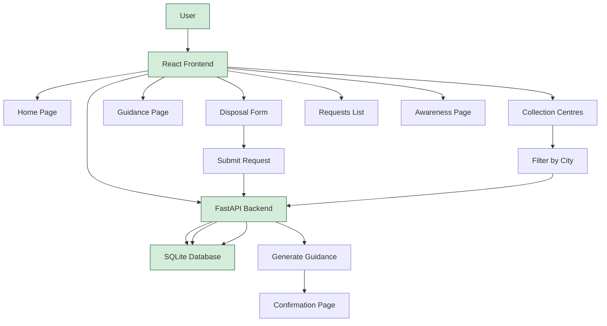

# Electronic Appliance Disposal System

A simple, complete, beginner-friendly college mini-project that helps users dispose of electronic appliances responsibly. Built with React + Vite (frontend), Python FastAPI (backend), and SQLite (database).

## 📋 Project Overview

The Electronic Appliance Disposal System is a web application designed to educate users about e-waste management and guide them through responsible disposal of electronic appliances. It provides information about the e-waste problem, helps users submit disposal requests, offers guidance based on appliance condition, maintains a directory of collection centres, and raises environmental awareness.

## ✨ Features

1. **Home Page** - Explains the e-waste problem and why responsible disposal matters
2. **Disposal Request Form** - Submit requests with name (optional), appliance type, condition, quantity, and city/area
3. **Disposal Guidance** - Recommendations for reuse/donation (working appliances) and authorised recycling (broken appliances)
4. **Collection Centre Directory** - Sample centres with filtering by city/area (clearly marked as demonstration data, no real addresses or live maps)
5. **Submission Confirmation** - Confirmation page with request details and personalized guidance
6. **Requests List** - View all submitted disposal requests
7. **Environmental Awareness** - E-waste impact information and practical recycling tips

## 🏗️ Architecture

### Tech Stack
- **Frontend**: React 18 with Vite
- **Backend**: Python FastAPI
- **Database**: SQLite (lightweight, file-based)
- **Styling**: CSS with green/white theme

### Architecture Flowchart



### Project Structure

```
E-Waste-Disposal/
├── backend/
│   ├── app/
│   │   ├── __init__.py
│   │   ├── database.py      # Database setup and seeding
│   │   └── main.py          # FastAPI application and routes
│   ├── tests/
│   │   ├── __init__.py
│   │   └── test_api.py      # API tests
│   └── requirements.txt     # Python dependencies
├── frontend/
│   ├── public/
│   ├── src/
│   │   ├── components/      # Reusable components (Navbar, Footer)
│   │   ├── pages/          # Page components
│   │   ├── styles/         # CSS styles
│   │   ├── App.jsx
│   │   └── main.jsx
│   ├── index.html
│   ├── package.json
│   └── vite.config.js
├── tests/                  # Additional tests (if needed)
├── docs/                   # Documentation
├── .gitignore
└── README.md
```

## 🔌 API Endpoints

| Method | Endpoint | Description | Parameters |
|--------|----------|-------------|------------|
| GET | `/` | API health check | - |
| GET | `/centres` | List all collection centres | `city_area` (optional) - filter by city/area |
| POST | `/requests` | Submit a new disposal request | JSON body with name, appliance_type, appliance_condition, quantity, city_area |
| GET | `/requests` | List all disposal requests | - |
| GET | `/requests/{id}` | Get specific disposal request | `id` - request ID |

### Request Body Example (POST /requests)
```json
{
  "name": "John Doe",           // optional
  "appliance_type": "Laptop",
  "appliance_condition": "working", // or "broken"
  "quantity": 1,
  "city_area": "Mumbai"
}
```

## 🗄️ Database Details

**Database**: SQLite (`backend/app/ewaste.db` - created on first run)

### Tables

**collection_centres**
- id (INTEGER PRIMARY KEY)
- name (TEXT) - Includes "Demo" prefix
- city_area (TEXT)
- address (TEXT) - Marked as "(Demonstration Data)"
- phone (TEXT)
- accepts_working (INTEGER)
- accepts_broken (INTEGER)

**disposal_requests**
- id (INTEGER PRIMARY KEY)
- name (TEXT, nullable)
- appliance_type (TEXT)
- appliance_condition (TEXT) - 'working' or 'broken'
- quantity (INTEGER)
- city_area (TEXT)
- status (TEXT) - default 'submitted'
- created_at (TIMESTAMP)
- guidance (TEXT) - Auto-generated based on condition

**Sample Data**: 5 demonstration collection centres seeded on first run.

## 🚀 Setup Instructions

### Prerequisites
- Python 3.8+ 
- Node.js 16+ and npm

### Backend Setup

1. Navigate to backend directory:
```bash
cd ~/Desktop/projects/E-Waste-Disposal/backend
```

2. Create and activate virtual environment (recommended):
```bash
python3 -m venv venv
source venv/bin/activate  # On Windows: venv\Scripts\activate
```

3. Install dependencies:
```bash
pip install -r requirements.txt
```

4. Run the backend server:
```bash
uvicorn app.main:app --reload --host 127.0.0.1 --port 8000
```

The backend will be available at `http://localhost:8000`. API docs at `http://localhost:8000/docs`.

### Frontend Setup

1. Navigate to frontend directory:
```bash
cd ~/Desktop/projects/E-Waste-Disposal/frontend
```

2. Install dependencies:
```bash
npm install
```

3. Run the development server:
```bash
npm run dev
```

The frontend will be available at `http://localhost:5173`.

### Build for Production

```bash
cd frontend
npm run build
```

The built files will be in `frontend/dist/`.

## 🧪 Running Tests

### Backend Tests
```bash
cd ~/Desktop/projects/E-Waste-Disposal/backend
python -m pytest tests/test_api.py -v
```

The tests cover:
- API root endpoint
- Collection centres listing and filtering
- Disposal request creation (valid cases, optional name)
- Input validation (invalid condition, invalid quantity)
- Requests listing
- Getting specific request by ID
- 404 for non-existent requests

## ⚠️ Limitations

- **No Authentication**: No user accounts or login required (as per requirements)
- **Demo Data Only**: Collection centres are sample data for demonstration - no real verified addresses
- **No Map Integration**: No live maps or geolocation features
- **No AI/ML**: All logic is rule-based
- **Local Storage Only**: Uses SQLite, not suitable for production scale
- **No External APIs**: Completely self-contained
- **Basic Validation**: Simple validation suitable for a college project

## 🎨 Design Features

- **Color Scheme**: Green and white theme representing environmental consciousness
- **Responsive Design**: Works on desktop and mobile devices
- **Accessibility**: Proper labels, ARIA attributes, semantic HTML
- **Clean UI**: Card-based layout with clear navigation
- **No Excessive Animations**: Simple, clean transitions

## 📝 Notes

- All collection centres are clearly marked as "Demo" and addresses include "(Demonstration Data)"
- No real verified addresses are provided
- No claims of live map integration
- All dependencies are open-source and free
- The project follows a simple, beginner-friendly architecture

## 👨‍💻 Development

This project was built as a college mini-project following all the specified requirements. It demonstrates full-stack development with React, FastAPI, and SQLite.
